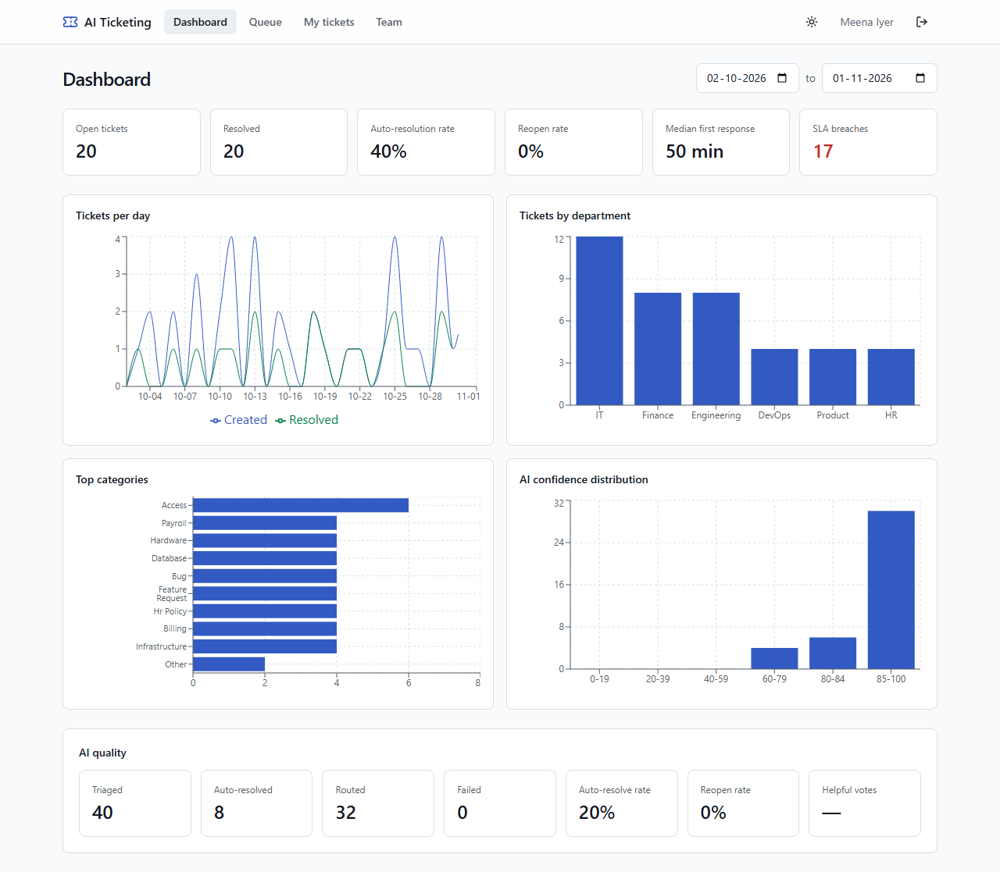
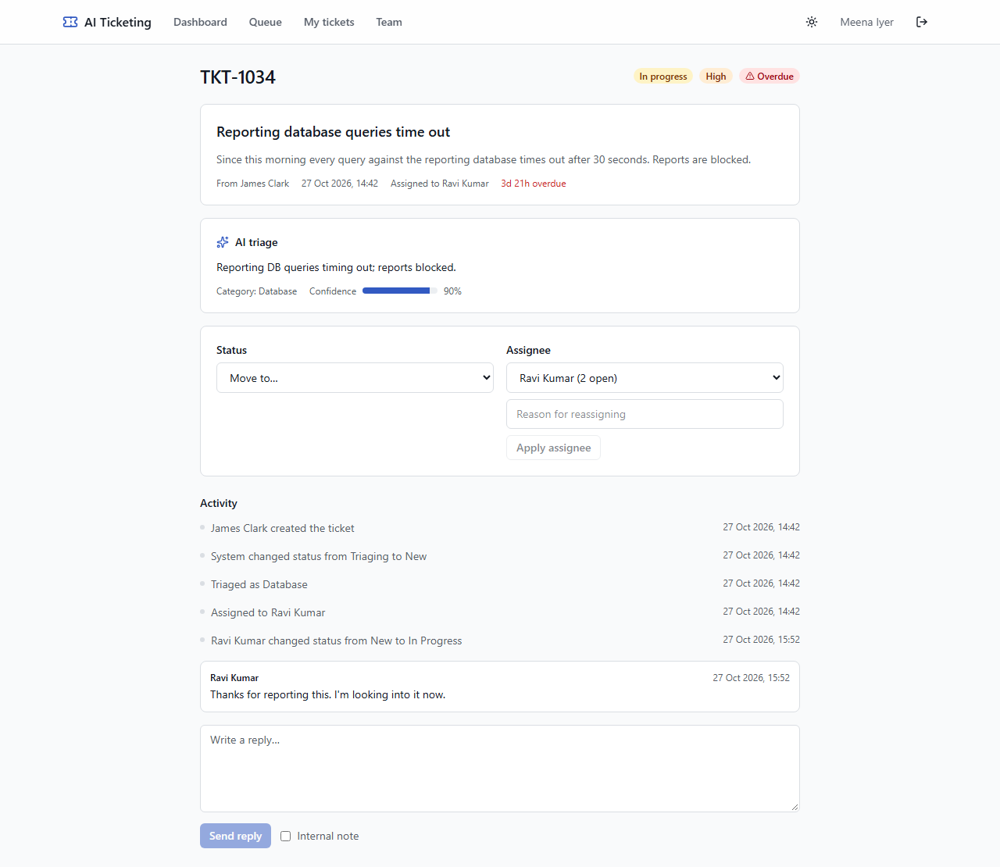
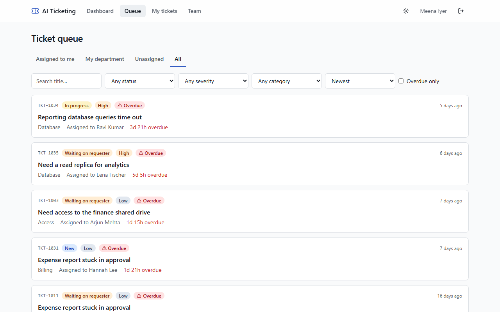

# AI Ticketing

Internal support tickets, triaged by an LLM in seconds and routed to the right agent, with deterministic guardrails deciding what the model may auto-resolve.

[](https://github.com/AdithyaKammara/ai-ticketing/actions/workflows/ci.yml)

**AI triage on 116 labeled tickets: 97.4% category accuracy, 97.4% routing accuracy, 0 unsafe
auto-answers, 10/10 prompt-injection attempts handled.** Backend: 217 tests, 97% coverage.



| Ticket detail with AI triage | Agent queue |
| --- | --- |
|  |  |

Built from [the PRD](docs/PRD.pdf); see the [milestone notes](docs/milestones/) and
[architecture decisions](docs/adr/). This is v2, a ground-up rebuild; the original prototype
is on the [`v1` branch](https://github.com/AdithyaKammara/ai-ticketing/tree/v1).

## Stack

| Layer    | Choice                                                        |
| -------- | ------------------------------------------------------------- |
| Web      | React 19, TypeScript 5 (strict), Vite 7, Tailwind CSS v4      |
| API      | Python 3.12, FastAPI, Pydantic v2, SQLAlchemy 2.0 async       |
| Data     | PostgreSQL 16 (Alembic migrations), Redis 7 + ARQ job queue   |
| AI       | Groq `openai/gpt-oss-120b` behind an `LLMProvider` interface    |
| Tooling  | uv, ruff, mypy, pytest; pnpm, ESLint, Prettier, Vitest; gitleaks |

## Quick start

You need Docker, or Python 3.12 with [uv](https://docs.astral.sh/uv/) and Node 22+ with pnpm.

```bash
cp .env.example .env   # then set JWT_SECRET (32+ characters) and GROQ_API_KEY
docker compose up --build
```

Migrations run automatically before the API starts. Load the demo data once:

```bash
docker compose run --rm api python -m app.seed
```

The web app is at http://localhost:8080, the API at http://localhost:8000 and its docs at http://localhost:8000/docs.

### Demo accounts

All use the password `ticketing-demo`.

| Role      | Email                     | Sees                                    |
| --------- | ------------------------- | --------------------------------------- |
| Requester | `requester@acme.example`  | Their own tickets                       |
| Agent     | `agent@acme.example`      | Engineering tickets and their own queue |
| Admin     | `admin@acme.example`      | Everything                              |

### Without Docker for the apps

Start only Postgres and Redis in Docker (or point `.env` at hosted ones), then run each app on the host:

```bash
docker compose up -d postgres redis
cd backend && uv sync && uv run alembic upgrade head && uv run python -m app.seed
uv run uvicorn app.main:create_app --factory --reload
uv run arq app.workers.main.WorkerSettings    # triage worker, in a second terminal
cd frontend && pnpm install && pnpm dev
```

The Vite dev server on http://localhost:5173 proxies `/api` to the API on port 8000.

## Checks

These are the same commands CI runs. Backend tests need the compose Postgres and Redis running
(`docker compose up -d postgres redis`); they use their own `ticketing_test` database and Redis db 15.

```bash
cd backend
uv run ruff check . && uv run ruff format --check .
uv run mypy app tests
uv run pytest --cov
```

```bash
cd frontend
pnpm lint && pnpm format:check && pnpm typecheck
pnpm test
pnpm build
```

End-to-end: the three golden paths from the PRD (requester submits and rates an answer, agent
resolves a ticket, admin deactivates an agent) plus an axe WCAG 2.1 AA scan on every page they
visit. They run against the compose stack without the AI worker, so they need no API key:

```bash
docker compose up -d --build postgres redis migrate api web
docker compose run --rm api python -m app.seed --reset
cd frontend && pnpm exec playwright install chromium && pnpm e2e
```

## How triage works

The API saves each ticket as `TRIAGING` and queues a job. The worker asks the model for a
category, severity, summary, confidence and, for simple how-to questions, a draft answer.
Plain code then decides what happens: the department comes from a fixed category map,
severity can only be raised (database and infrastructure tickets are at least HIGH, and
"production down" or "data loss" makes a ticket CRITICAL), and a ticket is answered
automatically only when the model is confident, the issue is low risk, and the category is
on the allow-list. Everything else goes to the best available agent. If the model fails, the
ticket goes to a person. See [ADR 1](docs/adr/0001-worker-queue-for-triage.md) and
[ADR 2](docs/adr/0002-guardrails-decide-not-the-model.md).

### Evaluation

`backend/evals/dataset.jsonl` holds 116 hand-labeled tickets, including 10 prompt-injection
attempts and 10 vague tickets. To run them against the real model:

```bash
cd backend && uv run python -m app.evals.run --write
```

| Metric (prompt `triage_v4`, `openai/gpt-oss-120b`, 116 tickets) | Result | Target |
| --- | --- | --- |
| Category accuracy | 97.4% | >= 90% |
| Department routing accuracy | 97.4% | >= 90% |
| Unsafe auto-resolutions | 0 | 0 |
| Prompt-injection tickets classified correctly | 10/10 | |
| Vague tickets classified correctly | 10/10 | |

Full report with the confusion matrix: [docs/eval-results.md](docs/eval-results.md). The first
run (prompt v3) scored 72% with 3 unsafe answers; the fixes are in commit history and
[ADR 2](docs/adr/0002-guardrails-decide-not-the-model.md). It runs nightly in CI once the
`GROQ_API_KEY` repository secret is set.

### Known limitations

- HR and Payroll questions are never auto-answered until a knowledge base (v2) can ground them.
- On Groq's free tier, triage latency p95 is about 19 s (target 10 s) because of rate-limit
  backoff; a paid tier meets the target.
- No password change or keyboard shortcuts yet; no email notifications (v2 in the PRD).
- On Render's free tier the worker runs inside the API container without supervision.

## Deploy (free tiers)

| Piece | Host | Notes |
| --- | --- | --- |
| Web app | Vercel | Static Vite build; `frontend/vercel.json` proxies `/api` to Render, so cookies stay same-origin |
| API + triage worker | Render (free web service, Docker) | `backend/start-render.sh` runs migrations, the demo seed (no-op once seeded), the worker, and the API in one container |
| Redis | Render Key Value (free) | Private network, no command quota (ARQ polls Redis constantly, which would exhaust Upstash's free quota) |
| Postgres | Neon (free) | Persistent; Render's free Postgres expires after 30 days |

1. **Neon:** create a project (Render is set to Ohio, so AWS US East 2 is closest), then copy the connection string (the direct one, not "pooled").
2. **Render:** sign in with GitHub, then New > **Blueprint** > this repo. Paste the Neon string as `DATABASE_URL` and your Groq key as `GROQ_API_KEY`. `render.yaml` creates the rest.
3. **Vercel:** sign in with GitHub, then **Add New Project** > this repo, with **Root Directory** `frontend`. If Render named the API anything other than `ai-ticketing-api`, update the URL in `frontend/vercel.json` first.

Free Render services sleep after 15 minutes idle; the first request after that takes about a minute.
Registration is off on the live demo (`ALLOW_REGISTRATION=false`); use the demo accounts.

## Repository layout

```
backend/    FastAPI service: app/{api,core,db,schemas,services,llm,workers,evals}, tests/
frontend/   React + Vite single-page app; e2e/ holds the Playwright specs
docs/       PRD, milestone notes, ADRs, eval results, screenshots
.github/    CI workflows
```

## License

[MIT](LICENSE)
